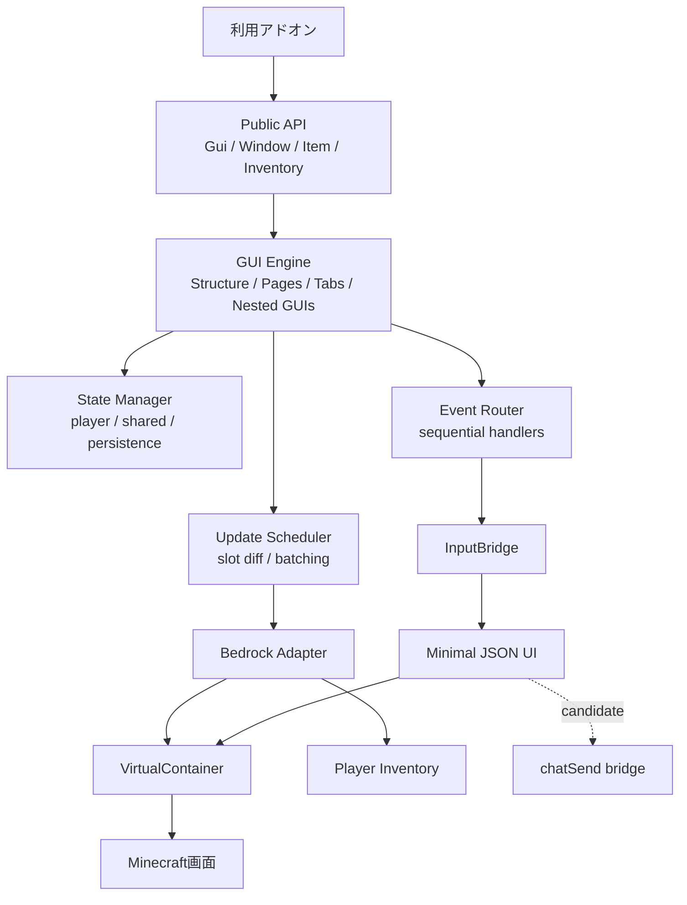
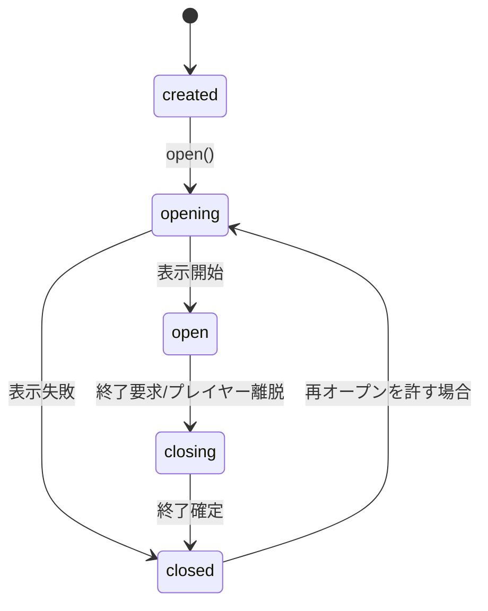

# InvUI for Bedrock — 全体設計書

> **設計バージョン:** 1.2（2026-11-13）  
> **対象:** Minecraft Bedrock Edition / `@minecraft/server` Experimental / TypeScript  
> **配布形態:** npmパッケージ＋必要最小限のResource Pack  
> **状態:** 基本仕様は合意済み。入力通知方式と`InventoryLink`の安全な移動処理は実機検証前。

## 0. 概要

Java版[InvUI](https://github.com/NichtStudioCode/InvUI)の設計と公開APIをできるだけ維持した、Bedrock Script API向けのGUIライブラリを開発する。

画面はScript API Experimentalの`VirtualContainer`を利用する。GUIレイアウト、アイテム、イベント、状態共有、保存、差分更新はTypeScriptで実装する。JSON UIはチェスト画面全体の置き換えには使わず、必要なスロットの操作抑制とクリック通知に限定する。

ライブラリ本体はnpmで提供し、利用者が`npm install`で導入できるようにする。JSON UIを配置するResource Packは別途必要であり、導入補助CLIを同梱する。

### 0.1 決定済みの事項

| 分類 | 決定内容 |
|---|---|
| 実装言語 | TypeScript |
| GUI基盤 | `VirtualContainer` |
| 互換方針 | Java版InvUIのクラス・メソッド名を優先し、Bedrock固有の制約は明示する |
| API形態 | 宣言型OptionsとBuilderを両方提供 |
| GUI種別 | `Gui`、`PagedGui`、`ScrollGui`、`TabGui` |
| クリック | 通常クリックのみ。左・右・Shift・ダブルクリックを区別しない |
| 状態の共有 | `player`または`shared`をAPIで指定 |
| 状態の保存期間 | `window`、`session`、`persistent` |
| 表示更新 | 影響を受けたスロットだけ更新 |
| イベント | 同じ共有状態への操作は順番に処理 |
| エラー | Window単位で隔離し、ハンドラーへ通知 |
| ライフサイクル | 通常終了、死亡、ディメンション移動、切断、スクリプト再読み込みに対応 |
| 配布 | npm、JavaScriptとTypeScript型定義を含む |
| Resource Pack | 必要最低限のJSON UIと導入補助CLIを同梱 |
| 外部GUIライブラリ | `@bedrock-core/ui`には依存しない |

### 0.2 未確定・実機検証が必要な事項

1. VirtualContainerのチェスト画面に追加した`edit_box`と`button.send`で、実際にチャット送信イベントが発生するか。
2. JSON UIの通常操作抑制と透明ボタンの重ね合わせが、PC・タッチ・コントローラーで期待どおり動くか。
3. InvUIの画面だけにJSON UIを適用する判定方式を、ほかのチェストに影響させず実装できるか。
4. `InventoryLink`で移動可能アイテムの重複・消失を防止できるか。
5. 27/54スロットと各種画面サイズ・入力方式における表示の整合性。

**重要:** 上記は採用を目指す設計であり、検証前の機能を「動作確認済み」とは扱わない。とくにJSON UIからScript APIへ任意の関数を直接呼ぶことはできない。

---

## 1. 目標・非目標

### 1.1 目標

- Java版InvUIで馴染みのあるクラス・メソッドを使えるようにする。
- `Structure`の文字列レイアウトを使ってGUIを構築できるようにする。
- `Item`、`ItemProvider`、`ItemBuilder`を分離する。
- ページ、スクロール、タブ、入れ子GUIを表現できるようにする。
- 開発者の記述方法としてOptions方式とBuilder方式を選べるようにする。
- 状態の共有・保存期間をWindow APIから指定できるようにする。
- GUIの更新を効率化し、同じアイテムが複数箇所に表示される場合にも対応する。
- ビルド可能なES Moduleと`.d.ts`をnpmに公開する。
- Resource Packの変更箇所と導入手順を明確化する。

### 1.2 初期リリースの非目標

- 左右クリック・Shiftクリック・ダブルクリックの区別。
- Bukkit/Paperのイベントオブジェクトの完全な再現。
- Anvil、Smithing、Merchantなど特殊UIの完全再現。
- Bedrock標準のプレイヤーインベントリUIそのものの自由な置き換え。
- リソースパック不要での高度なクリック検知。
- 任意のJSON UI部品をScript APIから実行時に生成すること。

### 1.3 互換性の定義

| レベル | 意味 |
|---|---|
| API互換 | 同名の公開クラス・メソッドを提供する。引数の型はBedrock向けに調整する |
| 意味互換 | 同等の処理結果を目指す。内部実装は異なってよい |
| 制限付き互換 | 同名で提供するが、Bedrockの制約を明記する |
| 非対応 | 初期リリースでは公開しない、または明示的な非対応エラーにする |

Java版で存在するすべてのクラスを、最初から動作するかのように公開しない。型定義と実行時動作が一致することを重視する。

---

## 2. 動作環境と前提

- **ゲーム:** Minecraft Bedrock Edition。`VirtualContainer`の存在する対応Preview/Betaを対象とする。
- **Script API:** `@minecraft/server` Experimental。具体的な対応バージョンはテスト済み組み合わせごとにリリースノートへ記載する。
- **言語:** TypeScriptを開発言語とし、ES Module JavaScriptへビルドする。
- **パッケージ管理:** npm。利用者のビルド時にライブラリをバンドルする。
- **表示:** 原則として標準チェストUI。最大54スロット、1行9スロット。
- **入力:** 小規模なJSON UI変更を用いる予定。動作が確定するまで実装方式は固定しない。

`VirtualContainer`はメモリ上のコンテナであり、ワールドに保存されない。スクリプト再読み込み時に画面は閉じる。画面終了イベントも発生しないため、状態の永続化を終了イベントに依存させない。

`VirtualContainer`の`size`と`title`は生成後に変更できない。レイアウトサイズやタイトルが変わる場合は、新しいコンテナを生成して開き直す設計とする。

---

## 3. 全体アーキテクチャ



### 3.1 Public API

利用者が直接使用する型。Minecraft固有の複雑な処理を隠し、InvUIに近い使い勝手を維持する。

### 3.2 GUI Engine

`Structure`、`Ingredient`、`Markers`からスロット配置を解決する。ページ・行・タブ・入れ子GUIの状態を計算する。

### 3.3 State Manager

状態の共有範囲、キー、保存期間、登録済みWindow、永続化用のシリアライズ可能なデータを管理する。

### 3.4 Update Scheduler

変更対象スロットの集合を保持し、同じタイミングで変更をまとめて反映する。不要な`ItemStack`生成・転送を抑える。

### 3.5 Event Router

クリック通知をプレイヤーとWindowのセッションへ割り当てる。操作の整合性、順序、失効したイベントの除外を担当する。

### 3.6 Bedrock Adapter

`VirtualContainer`の生成・表示・終了、Player Inventoryへのアクセス、各種Script APIイベント購読を担当する。

### 3.7 InputBridge

JSON UIの入力通知経路をカプセル化する。候補のチャット通知方式が使えなければ、公開APIを変えずに別の通知方式を採れるようにする。

---

## 4. 公開APIの構成

### 4.1 GUI関連

| 型 | 主要機能 |
|---|---|
| `Gui` | 通常GUI、Builderファクトリ、スロット管理 |
| `PagedGui<T>` | ページ、ページ数、コンテンツ管理 |
| `ScrollGui<T>` | 行・列方向へのスクロール |
| `TabGui` | タブ一覧と選択タブの管理 |
| `Structure` | 文字列レイアウト、Ingredientの割り当て |
| `Ingredient` | 表示アイテム、スロットリンク、マーカーなどの要素 |
| `Markers` | `CONTENT_LIST_SLOT_HORIZONTAL` / `_VERTICAL` |
| `SlotElement` | `Item` / `InventoryLink` / `GuiLink` |

### 4.2 アイテム関連

| 型 | 主要機能 |
|---|---|
| `Item` | GUI内の表示要素とクリック処理 |
| `ItemProvider` | 閲覧者ごとのアイテム生成 |
| `ItemBuilder` | `ItemStack`の作成・加工 |
| `Item.EMPTY` | 空の表示要素 |

### 4.3 インベントリ関連

| 型 | 主要機能 |
|---|---|
| `Inventory` | 保管領域の共通インターフェース |
| `VirtualInventory` | メモリ上の保管領域。永続化時にはシリアライズ |
| `InventoryLink` | GUIスロットと特定の保管領域スロットを対応付ける |

**区別:** ライブラリの`VirtualInventory`は、Script APIの`VirtualContainer`と異なる。前者は論理的な保管データ、後者はプレイヤーに画面を見せるためのコンテナ。

### 4.4 Window関連

| 型・機能 | 主要機能 |
|---|---|
| `Window` | GUIと1人の閲覧者を結び付ける |
| `Window.builder()` | Windowを段階的に設定する |
| `Window.mergedBuilder()` | Java版と同名のAPIを目指す。Bedrockでの挙動は制限付き |
| `setUpperGui()` | VirtualContainer側のGUI |
| `setLowerGui()` | 下側GUIの論理的な設定。標準プレイヤーUIの置換は保証しない |
| `setTitle()` | タイトル設定。表示中の変更は再生成を伴う |
| `open()` / `close()` | 表示開始・終了 |
| `addOpenHandler()` / `addCloseHandler()` | ライフサイクル通知 |
| `setStateScope()` | TypeScript版追加：共有範囲 |
| `setStateKey()` | TypeScript版追加：共有状態キー |
| `setStateLifetime()` | TypeScript版追加：状態保存期間 |
| `setErrorHandler()` | TypeScript版追加：例外ハンドラー |

`Gui.paged()`、`Gui.normal()`などの統一ファクトリはTypeScript版の便利APIとする。Java版由来の`Gui.builder()`、`PagedGui.itemsBuilder()`、`Item.builder()`、`Structure`も維持する。

---

## 5. GUI生成API

### 5.1 宣言型（Options）

```ts
import { Gui, Item, ItemBuilder, Markers } from "invui-bedrock";

const background = Item.simple(
  new ItemBuilder("minecraft:gray_stained_glass_pane")
);

const gui = Gui.paged({
  structure: [
    "#########",
    "#xxxxxxx#",
    "#########",
  ],
  ingredients: {
    "#": background,
    x: Markers.CONTENT_LIST_SLOT_HORIZONTAL,
  },
  content: items,
});
```

### 5.2 Builder

```ts
import { Gui, Structure, Item, ItemBuilder, Markers } from "invui-bedrock";

const structure = new Structure(
  "#########",
  "#xxxxxxx#",
  "#########"
)
  .addIngredient(
    "#",
    Item.simple(new ItemBuilder("minecraft:gray_stained_glass_pane"))
  )
  .addIngredient("x", Markers.CONTENT_LIST_SLOT_HORIZONTAL);

const gui = Gui.paged()
  .setStructure(structure)
  .setContent(items)
  .build();
```

どちらも内部で同じ正規化済み設定に変換する。**実装を二系統に分けない。**

### 5.3 `Structure`の規則

- 文字とスロットを1対1に対応付ける。
- 同一レイアウト内の全行を同じ幅にする。
- 有効幅は最大9、高さは最大6、合計最大54スロット。
- 未定義文字の取り扱いを固定する（初期仕様では未定義文字を空スロットとする）。
- 空白は用途を明確にし、ソース文字列内の空白除去とスロット数の解釈が矛盾しないようにする。
- 入れ子GUIの範囲外描画は禁止する。
- `CONTENT_LIST_SLOT_HORIZONTAL`は行優先、`_VERTICAL`は列優先の順序で配置する。
- 同一座標に要素が重なった場合の優先順位を定義し、曖昧な重なりは検証時に検出する。

### 5.4 GUI種別のモデル

**通常GUI（`Gui`）:** 固定スロット。背景、装飾、ボタン、論理的なインベントリリンクを扱う。

**`PagedGui`:** 指定したコンテンツスロット数からページ数を算出。ページ変更時は表示が変わる箇所のみ更新する。最終ページの未使用スロットは空にする。

**`ScrollGui`:** 行・列を単位として表示範囲を移動。スクロール開始位置は範囲内に丸める。表示幅とコンテンツ順を分離する。

**`TabGui`:** 選択した子GUIを表示する。タブごとの内部状態を保持するか、再選択時に初期化するかはGuiの状態データに明確に保持する。

**`GuiLink`:** 子GUIの要素を親の表示位置へ投影する。ネストは許可するが、循環参照は拒否する。

---

## 6. `Item`、`ItemProvider`、`ItemBuilder`

### 6.1 責任分担

- `ItemBuilder`: 表示に使う`ItemStack`を組み立てる。
- `ItemProvider`: プレイヤーや状態に応じて`ItemStack`を返す。
- `Item`: Providerとクリックハンドラーを保持し、変更を通知する。
- `SlotElement.Item`: `Item`をGUIの位置へ割り当てる。

### 6.2 使用例

```ts
const buyButton = Item.builder()
  .setItemProvider(
    new ItemBuilder("minecraft:diamond")
      .setName("購入")
      .addLoreLines("クリックして購入")
  )
  .addClickHandler(click => {
    // 通常クリック。左・右の区別はしない。
    const { player, slot, window } = click;
  })
  .updateOnClick()
  .build();
```

コードは公開APIの設計例であり、現時点で完成した実装ではない。

### 6.3 主なメソッド

| API | 挙動 |
|---|---|
| `Item.simple(providerOrStack)` | 固定表示アイテムを作成 |
| `Item.builder()` | Item Builderを作成 |
| `setItemProvider()` | Providerを差し替える |
| `addClickHandler()` | 通常クリックを受け取る |
| `notifyWindows()` | Itemを表示するWindowへ更新通知 |
| `updateOnClick()` | クリック後に再評価 |
| `updatePeriodically(ticks)` | 表示中の指定周期で再評価 |

### 6.4 Providerの実行

- 同じItemでも、閲覧者によって異なる表示結果を返してよい。
- Providerは変更対象スロットの再評価時に実行する。
- 生成が失敗した場合は前回の表示を維持してエラーを通知する。
- 非同期Providerはプレースホルダーを表示可能とし、完了時に当該スロットを更新する。
- 非同期の完了が遅れた場合、Window世代番号とアイテム世代番号を照合して古い結果を破棄する。
- アイテム参照の共有と`ItemStack`の実体共有を混同しない。必要に応じて`ItemStack`を複製する。

---

## 7. スロットとアイテム操作

### 7.1 内部操作モード

| モード | 表示 | 通常クリック | 実際のアイテム移動 |
|---|---|---|---|
| `display` | あり | ハンドラーなし | 不可 |
| `button` | あり | ハンドラー実行 | 不可 |
| `inventory` | あり | 保管領域操作 | 許可する設計 |

`display`、`button`、`inventory`は内部の役割分類。Java版InvUIの公開クラス名を強制的に置き換えない。

### 7.2 操作制御の注意点

`ItemLockMode.slot`はVirtualContainerのスロットを読み取り専用にする手段として使わない。プレイヤーのインベントリ側でのロック動作と混同しない。

標準のVirtualContainer変更イベントは変更後イベントである。アイテム移動を完全に事前キャンセルできる前提にはしない。

表示専用・ボタン用スロットはJSON UI側で元のアイテム操作を抑制する設計とし、実際の操作を許す`inventory`は分けて扱う。

### 7.3 `InventoryLink`

Java版InvUIに合わせて、リンク元`Inventory`とスロット番号を持つ。

- GUIへの表示変更はリンク元から伝播する。
- 移動が許可された場合、リンク元とリンク先を一貫した手順で更新する。
- アイテムの増減が一致しない操作は失敗として扱う。
- カーソル、プレイヤーインベントリ、VirtualContainerの状態を検査する。
- アイテムが画面を離れたあとで補充するだけの実装は採らない（複製事故を避ける）。
- リンクされた保管領域の変更は他の表示中Windowにも通知する。

`InventoryLink`は実機の安全性試験が完了するまで「対応予定・制限付き」として扱う。未検証の操作を黙って許可しない。

### 7.4 プレイヤーの下側インベントリ

`Window.setLowerGui()`は公開APIとして保持する。ただしBedrock標準チェスト画面のプレイヤーインベントリ領域をJava版同様に自由に描き換えられるとは扱わない。

初期実装では下側領域との**論理的な関連付け**と可能な範囲での`InventoryLink`を優先し、見た目の差し替えや特殊な操作は制限付きとして記載する。

---

## 8. Windowの設計

### 8.1 原則

- `Gui`はレイアウトと表示対象を定義する。
- `Window`は閲覧者、画面、状態、イベント、終了処理を管理する。
- 1つのWindowの閲覧者は1人とする。
- 同じGui定義を複数Windowで利用できる。
- 各Windowの`VirtualContainer`は原則として別インスタンス。

### 8.2 使用例

```ts
const window = Window.builder()
  .setViewer(player)
  .setTitle("ショップ")
  .setUpperGui(gui)
  .setStateScope("player")
  .setStateLifetime("window")
  .addCloseHandler(reason => {
    // クローズ時の処理
  })
  .setErrorHandler((error, context) => {
    console.warn(error, context);
  })
  .build();

window.open();
```

### 8.3 Window Builderの主なAPI

```ts
type StateScope = "player" | "shared";
type StateLifetime = "window" | "session" | "persistent";

interface WindowBuilder {
  setViewer(player: Player): this;
  setTitle(title: string): this;
  setUpperGui(gui: Gui): this;
  setLowerGui(gui: Gui): this;
  setStateScope(scope: StateScope): this;       // Bedrock版追加
  setStateKey(key: string): this;              // Bedrock版追加
  setStateLifetime(value: StateLifetime): this;// Bedrock版追加
  addOpenHandler(handler: () => void): this;
  addCloseHandler(handler: (reason: WindowCloseReason) => void): this;
  setErrorHandler(handler: ErrorHandler): this;// Bedrock版追加
  build(): Window;
}
```

この宣言は設計上の主要メソッドを示すもので、完全な型定義ではない。

### 8.4 表示中の変更

- **アイテム内容:** 差分更新。
- **ページ・タブ:** 差分更新。
- **同サイズの上側GUI差し替え:** スロット配置を再評価して差分更新。
- **タイトル:** `VirtualContainer`を再生成して開き直す。
- **サイズ:** 新しい`VirtualContainer`を生成する。
- **下側GUI:** Bedrock側の制約に従う。

内部的な開き直しを、ユーザーが自分で画面を閉じた場合と区別する。ハンドラーの重複実行を避ける。

---

## 9. 状態管理と共有

### 9.1 共有範囲

| `setStateScope()` | 意味 |
|---|---|
| `"player"` | プレイヤーごとに独立した状態。デフォルト |
| `"shared"` | 同じ状態キーに属するWindowが同じ状態を参照 |

### 9.2 共有キー

```ts
const window = Window.builder()
  .setViewer(player)
  .setUpperGui(gui)
  .setStateScope("shared")
  .setStateKey("main-shop")
  .build();
```

`shared`ではキーを必須とする。キーが同じでもGui構造・状態スキーマに互換性がない場合は登録時にエラーとし、偶然同じ文字列になった別画面の状態を混ぜない。

`player`では内部的にプレイヤーIDと状態キーを組み合わせる。プレイヤーの表示状態と共有データは別に扱う。

### 9.3 保存期間

| `setStateLifetime()` | 保持期間 |
|---|---|
| `"window"` | Windowの終了時に解放。共有状態は最後の利用者が離れた時点で解放 |
| `"session"` | すべてのWindowが閉じてもスクリプト実行中は保持 |
| `"persistent"` | 保存し、スクリプト再読み込み後も読み込む |

デフォルトは`window`。再読み込み後に残すのは状態データであり、開いていた画面そのものではない。

### 9.4 管理対象の状態

- `page` — ページ番号。
- `line` — スクロール開始行・列。
- `tab` — 選択タブ。
- `selection` — 選択状態。
- `data` — 開発者指定のシリアライズ可能な状態。

表示中かどうか、`Player`参照、`VirtualContainer`参照、入力セッション番号はWindowごとの実行状態とし、共有状態へ入れない。

### 9.5 状態の整合性

- 状態変更を専用の操作キューで順番に実行する。
- 変更後は購読Windowへ通知する。
- 新規Windowは登録時点の最新状態から描画する。
- 同じキーへ異なる永続化設定が持ち込まれた場合、状態管理者のルールで拒否する。
- ページ範囲などはコンテンツ更新時に再検証する。

### 9.6 `persistent`状態

```ts
interface StoredGuiState {
  version: number;
  scope: StateScope;
  key: string;
  ownerId?: string;
  guiState: {
    page?: number;
    line?: number;
    tab?: number;
    selection?: string;
    data?: unknown;
  };
}
```

永続化するデータはJSONなどへシリアライズ可能なものとする。ハンドラー関数、`Player`、`ItemStack`のライブ参照、`Window`、`VirtualContainer`などは直接保存しない。保存が必要なインベントリ内容は別の明示的なシリアライズ処理を使用する。

スクリプト再読み込み時に`VirtualContainer`は消滅し、開いていた画面も閉じる。永続化済みデータを復元して新しいWindowを作ることは可能だが、画面を自動的に再オープンすることは標準保証としない。

---

## 10. InputBridgeとクリック検知

### 10.1 目的

- `display`および`button`スロットのアイテムを取り出せないようにする。
- 視覚上は標準のチェストアイテム表示を維持する。
- `button`スロットへの通常クリックをScript APIへ伝える。
- クリック情報を正しいWindow・スロットへ配送する。
- クリック検知のために表示アイテムを消費しない方法を優先する。

### 10.2 想定経路

```text
プレイヤーがGUI内の透明ボタンをクリック
    ↓
JSON UIの入力マッピング
    ↓
InputBridgeが扱う通知経路
    ↓
Script APIイベント
    ↓
WindowRegistryで閲覧者とセッションを照合
    ↓
EventQueueへ投入
    ↓
該当ItemのhandleClick() / addClickHandler()
    ↓
必要なスロットだけ再描画
```

### 10.3 通知方式の候補

| 方式 | 利点 | 課題 | 状態 |
|---|---|---|---|
| `button.send`→チャット通知 | 表示用アイテムや操作用スロットを消費しない可能性 | チェスト画面で`button.send`が動くか未確認 | 第1候補・要検証 |
| `button.drop_one`→コンテナ変化 | 非公式のコンテナUI実装例がある | 操作用スロット・アイテムの移動/回収が必要 | 代替候補・要検証 |
| `VirtualContainerItemChangeAfterEvent`のみ | 公式のイベントを利用できる | 変更後であり、アイテムが動かないクリックは検知できない | 単独では不足 |

### 10.4 チャット通知の候補設計

概念上は次のような専用メッセージを生成する。

```text
!invui:<session-id>:<slot-index>:<sequence>
```

Script API側では`world.beforeEvents.chatSend`を用いる。専用プレフィックスのメッセージを検知した場合、通常のチャットへの表示はキャンセルする。

ただし、**チャット送信そのものがチェスト画面で成立するかを実証するまでは、この形式を実装確定としない。** 入力元のJSON UIに適切なチャット欄の内部状態が存在しなければ`button.send`だけでは機能しない可能性がある。

### 10.5 入力の安全性

チャット内容はプレイヤー本人が入力可能であるため、通知文字列を信用しない。

- 入力者が開いているWindowを持つこと。
- Session IDが現在のWindowに一致すること。
- 対象スロットがそのプレイヤーの現在の画面で`button`モードであること。
- ページ変更後など、古い世代の通知を処理しないこと。
- 通知の連続処理を制限すること。
- コマンド風のユーザー文字列だけで権限のある処理を実行しないこと。

セッションIDだけを秘密情報として扱って認証に用いることはしない。サーバー側のWindow状態と照合して実行可否を決める。

### 10.6 JSON UIに渡すデータ

標準チェスト画面には`container_items`コレクションがあり、各スロットの描画に用いられている。

JSON UIが読み取れる値（例: 特定のアイテムID関連情報、個数、耐久情報など）の範囲で表示状態を切り替える。ただし**任意の`ItemStack`プロパティがJSON UIへ渡るわけではない**。

また、通常表示するアイテムの個数を通信用コードとして書き換えると表示個数まで変わる。表示用データと制御用データが衝突しないようにする。専用マーカーを用いる場合も、54スロット制限を考慮する。

### 10.7 画面の識別

通常のチェストへの影響を避けるため、InvUI専用画面にだけ変更を適用する。

候補はタイトル等の固定情報と、必要に応じて専用マーカーを組み合わせる方式。ただしJSON UIの式で実際に照合可能な形式を確認するまでは、特定の文字列形式を確定しない。

### 10.8 実機検証の合格条件

1. InvUI画面だけにJSON UIの入力制御が適用される。
2. 通常のチェストで従来のアイテム移動操作が維持される。
3. 表示専用スロットのアイテムを取り出せない。
4. ボタンスロットを押すとScript APIへ通知が1回届く。
5. 通知からプレイヤーとスロット番号を特定できる。
6. 表示アイテムが消失・複製しない。
7. PC、タッチ、コントローラーで通常クリック相当の入力が成立する。
8. 画面終了後に遅れて届く入力が処理されない。

この検証に合格するまでは、クリック機能を「提供済み」としてnpmへ公開しない。

---

## 11. 差分更新

### 11.1 更新の起点

- `Item.notifyWindows()`。
- `ItemProvider`の結果変更。
- ページ・スクロール・タブの移動。
- `Structure`やIngredientの変更。
- `VirtualInventory`の変更。
- 共有状態の変更。
- 明示的なGUI更新要求。

### 11.2 更新手順

1. 変更されたItemや状態から、影響を受けるWindowとスロットを特定する。
2. 各Windowの`dirtySlots: Set<number>`へ登録する。
3. 同じ更新タイミング内の複数通知をまとめる。
4. 変更スロットだけProviderとレイアウトを評価する。
5. 前回描画内容と比較する。
6. 実際に表示が変わるスロットへだけ`VirtualContainer.setItem()`を適用する。

### 11.3 逆引き索引

```ts
type ItemId = string;
type WindowId = string;

interface RenderReference {
  windowId: WindowId;
  slot: number;
}

// ItemId → 表示箇所の一覧
// Map<ItemId, Set<RenderReference>>
```

同じItemが複数スロット・複数Windowに表示されている場合でも、すべてを適切に更新する。

### 11.4 レイアウト更新

ページやタブの切替では、変更前後の最終的なスロット配列を比較して更新箇所を求める。`Structure`のサイズが変わる場合は、既存コンテナを更新するだけではなくWindowの再生成を伴う。

### 11.5 更新周期

- 原則としてScript APIの次の安全な処理タイミングに反映する。
- 同一タイミングで複数回変更されても、最終表示状態を1回描画する。
- `updatePeriodically()`は表示中の対象Itemに限定する。
- 非表示になったItemの不要な周期更新を停止する。

---

## 12. イベント処理と競合制御

### 12.1 処理順序

クリック処理はWindowごと、共有状態に関連する場合は状態キーごとに順序付ける。

```text
入力を受信
  → Windowを検証
  → 状態キーの処理キューへ投入
  → 現在の状態・表示世代を検証
  → ハンドラーを実行
  → 状態変更を確定
  → dirtySlotsを登録
  → 差分を描画
```

### 12.2 非同期ハンドラー

非同期処理を許可する場合は、同じ状態に対する後続操作が古い値を利用しないよう逐次実行する。Windowが閉じられた場合、待機中のイベントを破棄する。

### 12.3 無効なイベント

- 既に閉じたWindowへの通知。
- 別のページへ移った後の古いスロット通知。
- 存在しないスロット番号。
- `display`/`inventory`を`button`として通知する操作。
- 一致しないセッション・プレイヤー・状態キー。

これらはユーザーのハンドラーを実行せずに破棄する。

---

## 13. Windowのライフサイクル



### 13.1 終了要因

| 要因 | 公式の終了理由・対応 |
|---|---|
| 通常の画面クローズ | `PlayerClosed` |
| 死亡 | `PlayerDied` |
| 切断 | `PlayerLeft`。この時点でPlayer参照が無効の場合がある |
| 観戦モードへ変更 | `PlayerSpectating` |
| サーバー側で終了 | `ServerClosed` |
| ディメンション移動 | `ServerClosed`として扱われる |
| 端末が画面を表示できなかった | 対応する終了理由を記録し、必要なら再表示可能にする |
| スクリプト再読み込み | 終了イベントが発生しない。別経路で再初期化する |

### 13.2 終了処理

- クリック入力の受付停止。
- EventQueueに残る未処理イベントの破棄。
- ProviderやInventoryへの更新購読解除。
- 周期更新タスク解除。
- WindowRegistryから登録解除。
- `window`状態の破棄、または`session`/`persistent`状態の保持。
- アイテム移動を扱う場合は、終了時に未確定移動を検査する。
- ユーザーへ終了イベントを重複通知しない。

### 13.3 スクリプト再読み込み

`VirtualContainer`は保存されず、再読み込み時に開いている画面は閉じる。通常の終了イベントに依存した永続化はできない。`persistent`状態は変更時点で保存し、シャットダウン時の保存処理を補助として扱う。

再読み込み後はライブラリとイベント購読を初期化する。GUI定義・イベントハンドラーはアドオン側の初期化処理で再登録する。

---

## 14. エラー処理

### 14.1 方針

- 原則として該当Windowだけに影響を閉じ込める。
- データの破損やアイテムの複製につながる処理は継続しない。
- エラーを黙殺せず、明示的なハンドラーまたはログへ通知する。
- 実装時には失敗した操作とWindow識別子を関連付けられるようにする。

### 14.2 エラー分類

| 分類 | 対応 |
|---|---|
| 無効な`Structure` | ビルド時またはWindow生成時に例外 |
| Guiサイズ超過 | 生成を拒否 |
| Provider例外 | 前回の表示を維持、通知 |
| クリックハンドラー例外 | 当該イベントを失敗として通知、他Windowは継続 |
| Window失効 | 後続イベントを破棄し終了処理 |
| 状態スキーマ不一致 | 共有登録または復元を拒否 |
| 永続化失敗 | エラー通知、再試行・復元可能性を記録 |
| インベントリ不整合 | 移動を停止して安全側へ処理 |
| InputBridge利用不可 | 入力機能を有効化しない。制限を明確に表示 |

### 14.3 API案

```ts
window.setErrorHandler((error, context) => {
  console.warn("InvUI error", error, context);
});
```

`context`には発生場所、Window識別子、対象スロット、失敗した操作などを含める。

---

## 15. npmパッケージの設計

### 15.1 利用者側の導入

```bash
npm install invui-bedrock
```

`invui-bedrock`は**仮のnpmパッケージ名**。公開登録済みという意味ではない。

TypeScriptからは次のように読み込む。

```ts
import {
  Gui,
  PagedGui,
  ScrollGui,
  TabGui,
  Structure,
  Markers,
  Item,
  ItemBuilder,
  Window,
  VirtualInventory,
} from "invui-bedrock";
```

### 15.2 何を配布するか

- 実行用JavaScript（ES Module）。
- TypeScript型定義（`.d.ts`）。
- Source Mapとライセンス。
- 必須Resource Packの差分・テンプレート。
- Resource Pack導入補助CLI。
- 使用例、バージョン対応表、セットアップ手順。

### 15.3 `package.json`の案

```json
{
  "name": "invui-bedrock",
  "version": "0.1.0-beta.1",
  "type": "module",
  "main": "./dist/index.js",
  "types": "./dist/index.d.ts",
  "exports": {
    ".": {
      "types": "./dist/index.d.ts",
      "default": "./dist/index.js"
    }
  },
  "bin": {
    "invui-bedrock": "./bin/cli.js"
  },
  "files": ["dist", "bin", "resource_pack", "README.md", "LICENSE"],
  "sideEffects": false
}
```

実装時に`@minecraft/server`の対応バージョンを明記する。`@minecraft/server`自体はMinecraftがゲーム内で提供するモジュールであり、npmの通常ライブラリと同じように最終JSへ埋め込まない。

### 15.4 利用アドオン側のビルド

例（`esbuild`）：

```bash
npx esbuild src/main.ts \
  --bundle \
  --format=esm \
  --platform=neutral \
  --external:@minecraft/server \
  --outfile=behavior_pack/scripts/main.js
```

実際の`manifest.json`には、そのゲーム版で利用できる`@minecraft/server`の正しい依存バージョンを指定する。

### 15.5 公開時の確認

- `npm pack --dry-run`で同梱ファイルを検査する。
- 公開したtarballから実際に利用者環境でビルドできることを確認する。
- `.d.ts`のパスが正しいことを確認する。
- CLIがnpmインストール後に実行可能であることを確認する。
- `@minecraft/server`が誤ってバンドルされていないことを確認する。
- ビルドツールに依存しすぎないES Moduleを生成する。

---

## 16. Resource Packと導入CLI

### 16.1 基本思想

npmはBehavior PackのScript本体を利用するためのパッケージ管理手段。Resource Pack内のJSON UI変更は別の導入工程が必要。

導入補助CLIをパッケージに同梱する。

```bash
npx invui-bedrock init
```

具体的には対象Behavior Pack／Resource Packの場所を確認し、必要なファイルを配置・検証する設計。

### 16.2 CLIの責任

- 既存のBehavior PackとResource Packを発見またはパス指定で受け取る。
- 必要なJSON UIファイルと変更対象を示す。
- 既存の`chest_screen.json`などを勝手に上書きしない。
- 既存内容と競合する場合は自動変更を止め、差分を提示する。
- 変更したファイルについてバックアップまたは復元手段を用意する。
- パックが必要な設定を満たしているか静的に検査する。
- Experimental APIの有効化など、ゲーム内操作が必要な事項は手順を示す。

### 16.3 CLIの例（提案）

```bash
npx invui-bedrock init \
  --behavior-pack ./behavior_pack \
  --resource-pack ./resource_pack

npx invui-bedrock check
```

`check`は将来的な補助コマンド案であり、まだ仕様確定ではない。

### 16.4 JSON UIファイルの扱い

Resource Pack内に`invui.json`を追加するだけで既存チェスト画面へ自動接続されると決めつけない。必要な画面への参照・拡張方式は実際のJSON UI仕様に沿って実装する。

また、UIの実装方式によりほかのResource Packと競合する可能性がある。競合をゼロにできると保証せず、変更範囲を最小化する。

### 16.5 Resource Packなしの場合

ライブラリの型やレイアウト計算は使用可能。ただしクリック入力を必要とするWindowは正常に動かない可能性がある。利用者が利用可能な機能を誤解しないよう、導入条件をREADMEに明記する。

---

## 17. 推奨ディレクトリ構成

```text
invui-bedrock/
├── src/
│   ├── api/
│   │   ├── gui/
│   │   │   ├── Gui.ts
│   │   │   ├── PagedGui.ts
│   │   │   ├── ScrollGui.ts
│   │   │   ├── TabGui.ts
│   │   │   ├── Structure.ts
│   │   │   ├── Ingredient.ts
│   │   │   ├── Markers.ts
│   │   │   └── SlotElement.ts
│   │   ├── item/
│   │   │   ├── Item.ts
│   │   │   ├── ItemProvider.ts
│   │   │   └── ItemBuilder.ts
│   │   ├── inventory/
│   │   │   ├── Inventory.ts
│   │   │   └── VirtualInventory.ts
│   │   └── window/
│   │       └── Window.ts
│   ├── core/
│   │   ├── GuiEngine.ts
│   │   ├── LayoutResolver.ts
│   │   ├── StateManager.ts
│   │   ├── StateStore.ts
│   │   ├── EventQueue.ts
│   │   ├── UpdateScheduler.ts
│   │   ├── WindowRegistry.ts
│   │   └── ErrorDispatcher.ts
│   ├── bedrock/
│   │   ├── VirtualContainerAdapter.ts
│   │   ├── PlayerInventoryAdapter.ts
│   │   ├── InputBridge.ts
│   │   ├── ChatInputBridge.ts
│   │   ├── LifecycleManager.ts
│   │   └── PersistenceAdapter.ts
│   └── index.ts
├── resource_pack/
│   └── ui/
│       └── invui.json
├── bin/
│   └── cli.js
├── tests/
│   ├── unit/
│   ├── integration/
│   └── manual-bedrock/
├── examples/
├── dist/
├── package.json
├── tsconfig.json
├── README.md
└── LICENSE
```

`api`は公開用、`core`はできるだけScript APIに依存しない計算用、`bedrock`はゲームとの接続用に分離する。これにより、レイアウト・状態・差分計算はゲームを起動せずに検証できる。

---

## 18. テスト計画

### 18.1 自動テスト

- レイアウトの幅・高さ・文字割り当て。
- 未定義Ingredient、入れ子GUI、循環参照。
- ページ数・行数・タブ番号の境界値。
- 同一Itemを複数箇所へ配置した際の差分通知。
- 共有状態の同時変更、キュー順序。
- `window`/`session`/`persistent`の保存期間。
- 永続化データのシリアライズとバージョン移行。
- 非同期ItemProviderの古い結果の破棄。
- ハンドラー例外時の隔離。
- ビルド済みnpmパッケージのImportと型検査。

### 18.2 Bedrock実機テスト

- 9、27、54スロットの表示。
- PC、タッチ、コントローラーのクリック検知。
- 普通のチェストにJSON UI変更が作用しないこと。
- 表示用アイテムの持ち出し・ドロップ・複製ができないこと。
- 表示中のページ・タブ・タイトル変更。
- 複数プレイヤーが共有Guiを操作する場合の整合性。
- プレイヤー切断・死亡・ディメンション移動。
- スクリプト再読み込み後のpersistent状態の復元。
- `InventoryLink`でのクリック、ドラッグ、画面終了、カーソル上のアイテム等の整合性。
- 既存Resource Packとの競合の確認。

### 18.3 初期リリースの完了条件

1. 宣言型とBuilder型の主要APIが同じ結果を生む。
2. Normal / Paged / Scroll / Tabの表示・更新が動作する。
3. Windowの状態管理3種と共有範囲2種が動作する。
4. 差分更新で不要なスロットの書き換えが発生しない。
5. クリック入力を正式機能として公開する場合、InputBridgeの実機試験を通過する。
6. `InventoryLink`を正式機能として公開する場合、アイテム安全性試験を通過する。
7. npm経由の導入・バンドル・型検査が再現できる。
8. Resource Packの変更箇所・導入手順・対応ゲーム版が明示されている。

未検証機能は初期リリースから外すか、明確に実験的機能として区別する。

---

## 19. 開発フェーズ

| フェーズ | 内容 | 完了条件 |
|---|---|---|
| 0. 技術検証 | VirtualContainer、JSON UIの入力抑制、`button.send`、InputBridge | 入力方式の可否を明確化 |
| 1. コアAPI | Structure、Ingredient、Gui、Item、Window | 主要型を定義し、レイアウトが計算できる |
| 2. 表示 | VirtualContainer Adapter | アイテムが正しい位置へ表示される |
| 3. 動的GUI | PagedGui、ScrollGui、TabGui、GuiLink | ページ・行・タブ切替が動く |
| 4. 更新 | 差分描画、Provider通知 | 必要なスロットのみ更新する |
| 5. 状態管理 | Scope、Key、Lifetime、永続化 | プレイヤー別・共有状態が動く |
| 6. イベント | 通常クリック、処理キュー、エラー隔離 | 入力と状態変更が整合する |
| 7. Inventory | VirtualInventory、InventoryLink | アイテム移動が安全に動く |
| 8. 配布 | npm、CLI、README、例、対応表 | インストールから実機使用まで再現可能 |

InputBridgeに技術的な問題がある場合、見た目だけ整ったクリックAPIを先行して完成扱いにしない。問題を早期に検出するため、フェーズ0を優先する。

---

## 20. リスクと対策

| リスク | 影響 | 対策 |
|---|---|---|
| `button.send`がチェスト画面で無効 | チャット通知方式が使えない | InputBridgeを抽象化し、代替方式を検討 |
| JSON UIが通常チェストにも適用される | プレイヤーの通常操作を壊す | InvUI画面の識別を最初に検証 |
| JSON UIの入力抑制が機種ごとに異なる | タッチ・コントローラーで誤操作 | 入力方式ごとの実機テスト |
| `InventoryLink`で移動後に補充すると複製 | アイテム重複・消失 | 事前の完全な制限、移動結果の整合確認 |
| VirtualContainerの仕様変更 | バージョン間の非互換 | Adapter層分離、対応表、ベータ版運用 |
| 共有GUIの競合 | ページ・タブ・状態が混ざる | 状態キーとスキーマ検証、順序付き更新 |
| 再読み込み時に終了イベントが出ない | 状態が失われる | 変更時保存、再初期化で復元 |
| GUIのタイトル・サイズを直接変更できない | 画面の開き直しが必要 | Window内で再生成を管理 |
| Resource PackのJSON UI競合 | 導入失敗・他パックへの影響 | CLIの上書き防止・差分検査 |
| npmが利用できてもゲームへ直接ロードできない | 導入時に混乱 | ビルド手順・実例を同梱 |

---

## 21. 設計上の最終判断

### 21.1 変更しない基本原則

1. 公開APIはInvUIとの互換性を優先する。
2. 宣言型とBuilder型を両方サポートする。
3. GUIの表示内容・状態・イベントはTypeScript側で管理する。
4. `VirtualContainer`は画面表示の基盤とする。
5. JSON UIの変更は必要最低限にする。
6. 通常クリックのみを正式な入力イベントとする。
7. Windowごとの状態管理をAPIから設定できるようにする。
8. 状態共有は`player`/`shared`、保存期間は`window`/`session`/`persistent`。
9. 更新は差分反映を原則とする。
10. ライフサイクルとエラー処理をライブラリ内部で管理する。
11. `@bedrock-core/ui`に依存しない。
12. npmを正式な配布手段とし、JSON UI導入補助CLIを同梱する。

### 21.2 公開前に必ず確定する事項

- InputBridgeの実際のクリック通知方式。
- ボタン用スロットの移動抑制。
- 通常チェストとInvUI画面の識別。
- `InventoryLink`の安全なアイテム移動方式。
- 検証済みMinecraft / `@minecraft/server`バージョン。

この5点以外は基本設計としてまとまっている。実装では互換性を守りながら、上記の実機試験結果を踏まえてBedrock Adapterの仕様を確定する。

---

## 22. 参考資料

### 公式

- [Java版InvUI — GitHub](https://github.com/NichtStudioCode/InvUI)
- [Java版InvUIの`Gui`実装](https://github.com/NichtStudioCode/InvUI/blob/main/invui/src/main/java/xyz/xenondevs/invui/gui/Gui.java)
- [Java版InvUIの`Window`実装](https://github.com/NichtStudioCode/InvUI/blob/main/invui/src/main/java/xyz/xenondevs/invui/window/Window.java)
- [Microsoft — `VirtualContainer`](https://github.com/MicrosoftDocs/minecraft-creator/blob/main/creator/ScriptAPI/minecraft/server/VirtualContainer.md)
- [Microsoft — `VirtualContainerOptions`](https://github.com/MicrosoftDocs/minecraft-creator/blob/main/creator/ScriptAPI/minecraft/server/VirtualContainerOptions.md)
- [Microsoft — `VirtualContainerItemChangeAfterEvent`](https://github.com/MicrosoftDocs/minecraft-creator/blob/main/creator/ScriptAPI/minecraft/server/VirtualContainerItemChangeAfterEvent.md)
- [Microsoft — `VirtualContainerCloseReason`](https://github.com/MicrosoftDocs/minecraft-creator/blob/main/creator/ScriptAPI/minecraft/server/VirtualContainerCloseReason.md)
- [Microsoft — Script Module Versioning](https://github.com/MicrosoftDocs/minecraft-creator/blob/main/creator/Documents/scripting/versioning.md)
- [Mojang — `chest_screen.json`](https://github.com/Mojang/bedrock-samples/blob/main/resource_pack/ui/chest_screen.json)
- [Mojang — `chat_screen.json`](https://github.com/Mojang/bedrock-samples/blob/main/resource_pack/ui/chat_screen.json)
- [Mojang — npm配布ライブラリの実例](https://github.com/Mojang/minecraft-scripting-libraries)

### 非公式・実装調査用

- [Bedrock Wiki — JSON UI](https://wiki.bedrock.dev/json-ui/json-ui-documentation)
- [`bedrock-core/ui` — コンテナとJSON UIの動作調査](https://github.com/bedrock-core/ui/blob/main/docs/spikes/jsonui-container-facts.md)
- [`bedrock-core/ui` — チェスト入力定義](https://github.com/bedrock-core/ui/blob/main/packages/ui-compiler/src/connectors/chest/cell.ts)
- [JSON UIチャットボタンの実装例](https://github.com/cd-cm-pro/minecraft-bedrock-json-ui-examples/blob/main/20260612.json#L681-L768)

> 非公式資料は設計の参考。ゲーム版・画面条件が異なる実装例を、VirtualContainerでの動作保証と同一視しない。
